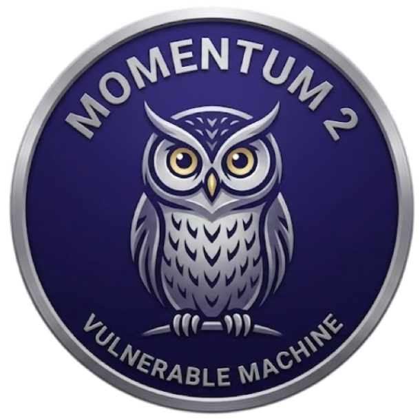
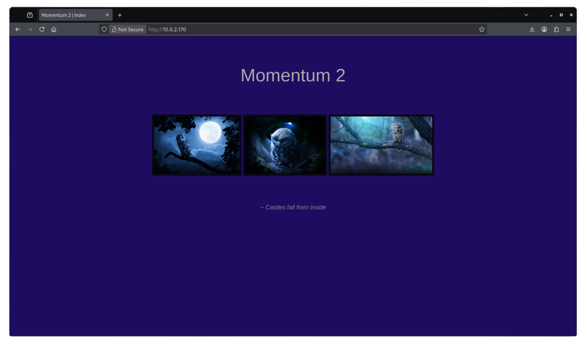

# Momentum2 - Penetration Testing
Penetration test of Momentum 2, a deliberately vulnerable virtual machine from VulnHub, carried out for academic purposes as part of the PTEH course.

<p align="center" style="flex; justify-items: center; align-items: center;">
  
</p>

# Overview
The assessment was performed in a black box approach inside an isolated lab (Proxmox VE, Kali Linux attacker), following the canonical phases of the General Penetration Testing Framework: information gathering, target discovery, enumeration and port scanning, vulnerability mapping, exploitation and post-exploitation.

<p align="center" style="flex; justify-items: center; align-items: center;">
  
</p>

The machine was fully compromised up to root privileges. Automated scanners did not reveal any directly exploitable high-severity flaw: the compromise was achieved through manual code review, chaining a backup-file exposure, hard-coded credentials, an unrestricted file upload and an overly permissive sudo configuration.

# Escalation scripts
Proof-of-concept scripts that automate the privilege escalation chain against the Momentum 2 VM. They are provided to make the exploitation phase easily reproducible; for further information, please check the documentation folder.

> For educational use only, inside the authorized, isolated lab. Do not run against systems you do not own or have explicit permission to test.

## Prerequisites
- Target reachable at `10.0.2.170` (adjust the TARGET variable if different).
- `sshpass` and/or `expect` installed on the machine where noted.
- The athena password recovered from `password-reminder.txt` (myvulnerableapp* — the [Asterisk] note stands for *).

## Usage
```
chmod +x *.sh

# Full chain from the attacker box:
./full_escalation.sh

# Or, step by step on the target:
./become_athena.sh
./privesc_athena_to_root.sh
```

## Info and credits
This project was created for the course "Penetration Testing and Ethical Hacking" at the Università degli Studi di Salerno. 
- [Momentum: 2 - VulnHub](https://www.vulnhub.com/entry/momentum-2,702/)

## License
This project is licensed under the MIT License. See the LICENSE file for details.
